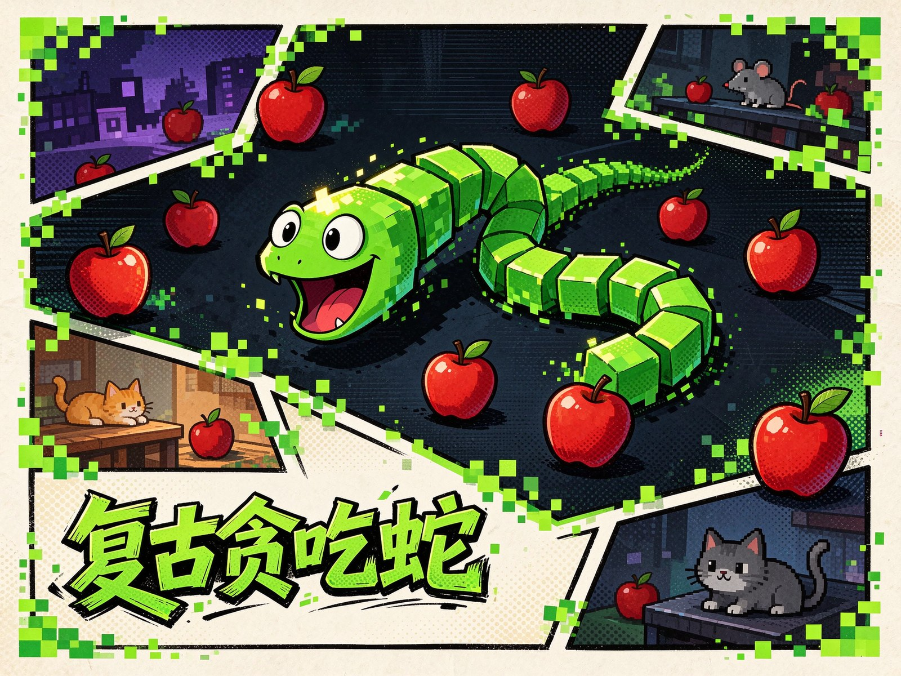

<p align="center"></p>

<h1 align="center">复古贪吃蛇</h1>

<p align="center">HTML5 Canvas 写的像素风贪吃蛇，键盘与触屏都能玩</p>

<p align="center">
  <a href="http://games.aikex.ink/">在线玩</a> ·
  <a href="https://github.com/aiyangdie/retro-games-hub">源码仓库</a>
</p>

## 简介

用 ES6 Class 重构的经典贪吃蛇：深色复古配色、Courier 字体，吃得越多跑得越快。最高分存本地，关掉浏览器也不丢。

## 功能

- **经典玩法**：方向键控蛇，吃食物变长
- **动态难度**：每吃一个食物提速一次
- **最高分**：localStorage 持久化
- **移动端**：响应式虚拟方向键，触屏可玩
- **碰撞判定**：撞墙或撞到自己即结束
- **代码结构**：`SnakeGame` 类封装状态与主循环，便于改玩法

## 规则

| 项目 | 说明 |
|---|---|
| 目标 | 控制蛇吃掉食物 |
| 得分 | 每个食物 +10 |
| 加速 | 每吃一个速度递增 |
| 结束 | 撞墙或撞到自身 |

## 快速开始

```bash
git clone https://github.com/aiyangdie/retro-games-hub.git
cd retro-games-hub
```

三种运行方式：直接打开 `index.html`；VSCode Live Server；`python -m http.server 8080`。

## 项目结构

```
index.html      游戏主页面
css/style.css   复古样式与响应式布局
js/game.js      核心逻辑（SnakeGame Class）
```

## 许可证

仓库未附 LICENSE 文件，使用与分发请先联系作者确认。
